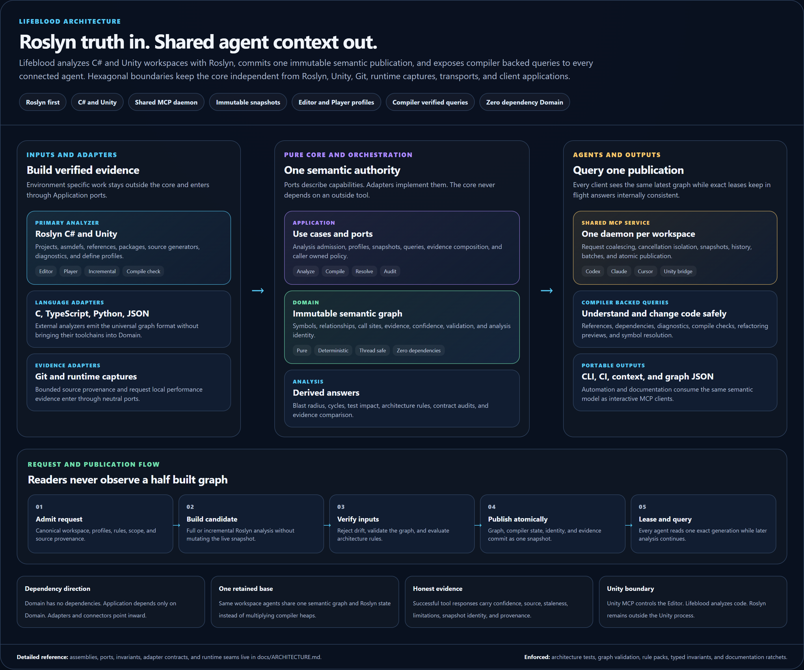

# Lifeblood

Compiler-as-a-service for AI agents.

Lifeblood gives AI agents direct access to what compilers know. Type resolution, call graphs, diagnostics, reference finding, code execution. All over a standard MCP connection. No IDE required. Load a project, ask the compiler, get verified answers.
Compilers already know everything about your code, just pipe that truth to AI agents instead of letting them grep and guess.

```
Roslyn (C#)    ──┐                              ┌──  Execute code against project types
TypeScript     ──┤  ┌────────────────────────┐  ├──  Diagnose / compile-check
JSON graph     ──┼→ │    Semantic Graph      │ →┤──  Find references / rename / format
               ──┤  │  (symbols / edges /    │  ├──  Blast radius / file impact
  community    ──┘  │   evidence / trust)    │  └──  Context packs / architecture rules
  adapters          └────────────────────────┘
```

Born from shipping a [400k LOC Unity project](https://github.com/user-hash/LivingDocFramework/blob/main/docs/CASE_STUDY.md) with AI assistance and realizing that AI writes code but does not verify what it wrote.

---

## Quick Start

### Install (30 seconds)

```bash
dotnet tool install --global Lifeblood
dotnet tool install --global Lifeblood.Server.Mcp
```

Requires [.NET 8 SDK](https://dotnet.microsoft.com/download/dotnet/8.0).

### Connect to Claude Code, Cursor, or any MCP client

Add to your project's `.mcp.json`:

```json
{
  "mcpServers": {
    "lifeblood": {
      "command": "lifeblood-mcp",
      "args": []
    }
  }
}
```

See [MCP Setup Guide](docs/MCP_SETUP.md) for Claude Desktop, VS Code, Cursor, and raw stdio configs.

### Use

```
lifeblood_analyze projectPath="/path/to/your/project"   → load semantic graph
lifeblood_blast_radius symbolId="type:MyApp.AuthService" → what breaks if I change this?
lifeblood_file_impact filePath="src/AuthService.cs"      → what files are affected?
lifeblood_find_references symbolId="type:MyApp.IRepo"    → every caller, every consumer
lifeblood_search query="quantize timing to grid"         → ranked keyword + xmldoc search
lifeblood_invariant_check id="INV-CANONICAL-001"         → query architectural invariants from CLAUDE.md
lifeblood_compile_check code="var x = 1 + 1;"            → snippet compiles, auto-wraps for library modules
lifeblood_execute code="typeof(MyApp.Foo).GetMethods()"  → run C# against your types
```

After the first analysis, use `incremental: true` for fast re-analysis (seconds instead of minutes).

### CLI (for CI and scripting)

```bash
lifeblood analyze --project /path/to/your/project
lifeblood analyze --project /path/to/your/project --rules hexagonal
lifeblood context --project /path/to/your/project
lifeblood export  --project /path/to/your/project > graph.json
```

### Build from source

```bash
git clone https://github.com/user-hash/Lifeblood.git
cd Lifeblood
dotnet build
dotnet test
```

---

## 25 Tools

Connect an MCP client. Load a project. The AI agent gets **25 tools**: 15 read, 10 write.

| | Tools |
|---|---|
| **Read** | Analyze, Context, Lookup, Dependencies, Dependants, Blast Radius, File Impact, Resolve Short Name, Search, Dead Code¹, Partial View, Invariant Check, Authority Report, Port Health, Cycles |
| **Write** | Execute, Diagnose, Compile-check, Find References, Find Definition, Find Implementations, Symbol at Position, Documentation, Rename, Format |

Every read-side tool that takes a `symbolId` routes through one resolver. Exact canonical id, truncated method form, bare short name, kind correction (`method:NS.Type.X` resolves to a property/field/event named `X` when no method exists; v0.6.6 / `INV-RESOLVER-006`), and wrong-namespace-correct-short-name (v0.6.3 / `INV-RESOLVER-005`) all resolve to the same answer.

Every read-side response carries a typed truth envelope (v0.6.7 / `INV-ENVELOPE-001`): truth tier (Semantic / Derived / Heuristic / Inferred), confidence band (Proven / Advisory / Speculative), evidence-source string, wall-clock staleness in seconds, files-changed-since-analyze count, per-tool documented limitations.

- **Truth envelope** on every read-side response (P2).

- **Unity-aware reachability** + asmdef-edit incremental detection (P3).

- **Execute robustness**: Unity DLL probe (`Library/ScriptAssemblies`, `Library/Bee/artifacts`, `Library/PackageCache`), `targetProfile` for runtime ref-pack selection (`host` / `net-standard-2.1` / `net-6.0`), sandbox introspection helpers `Help` / `SymbolsOfKind(string)` / `EdgesOfKind(string)` (P4).

- **Authority + port health + cycles tools** plus a forwarder classifier on every method (`PureForwarder` / `ThinWrapper` / `RealLogic`) (P5).

- **Resolver kind correction**, file-scoped diagnose, `compile_check` from disk, `blast_radius` summarize mode + direct-vs-transitive split (P1).

[Full tool reference](docs/TOOLS.md)

---

## Architecture

Hexagonal. Pure domain core with zero dependencies. Language adapters on the left, AI connectors on the right.

```
LEFT SIDE                     CORE                     RIGHT SIDE
(Language Adapters)        (The Pipe)               (AI Connectors)

Roslyn (C#)       ──┐                            ┌──  MCP Server (25 tools)
TypeScript        ──┼→  Domain  →  Application  →┤──  Context Pack Generator
JSON graph        ──┘       ↑                     ├──  Instruction File Generator
                      Analysis (optional)         └──  CLI / CI
```

26 port interfaces, all wired (left-side adapters + right-side connectors + `ISymbolResolver` for identifier resolution + `IResponseDecorator` for truth envelope + `IInvariantProvider` for CLAUDE.md invariant introspection + `IUnityReachabilityProvider` for runtime-dispatch reachability + `IRuntimeAssemblyResolver` for execute-time DLL probing + `IAuthorityReporter` for type-level authority reports). Boundaries enforced by [architecture invariant tests](tests/Lifeblood.Tests/ArchitectureInvariantTests.cs), 70 typed invariants in [CLAUDE.md](CLAUDE.md) (queryable via `lifeblood_invariant_check`), and [11 frozen ADRs](docs/ARCHITECTURE_DECISIONS.md).



[Full architecture](docs/ARCHITECTURE.md) | [Interactive diagram](docs/architecture.html)

---

## Three Languages, One Graph

| Adapter | How it works | Confidence |
|---------|-------------|------------|
| **C# / Roslyn** | Compiler-grade semantic analysis. Cross-module resolution. Bidirectional: analysis + code execution. | Proven |
| **TypeScript** | Standalone Node.js. `ts.createProgram` + `TypeChecker`. | High |
| **Python** | Standalone `ast` module. Zero dependencies. | Structural |
| **Any language** | Output JSON conforming to `schemas/graph.schema.json`. [Adapter guide](docs/ADAPTERS.md). | Varies |

---

## Unity Integration

Lifeblood runs as a sidecar alongside [Unity MCP](https://github.com/CoplayDev/MCPForUnity). All 25 tools available in the Unity Editor via `[McpForUnityTool]` discovery. Runs as a separate process, so no assembly conflicts, no domain reload interference.

`lifeblood_dead_code` recognizes Unity message-dispatch patterns automatically: `MonoBehaviour` magic methods (`Awake`, `Update`, `OnTriggerEnter`, full Unity catalog), entrypoint attributes (`RuntimeInitializeOnLoadMethod`, `MenuItem`, `ContextMenu`, `CustomEditor`, ...), transitive bases (`ScriptableObject`, `Editor`, `EditorWindow`, `StateMachineBehaviour`). `lifeblood_execute` auto-injects DLLs from `Library/ScriptAssemblies/`, `Library/Bee/artifacts/`, and `Library/PackageCache/` so scripts can touch `UnityEngine` types without Unity being open.

[Unity setup guide](docs/UNITY.md)

---

## Dogfooding

Lifeblood audits its own architectural invariants via `lifeblood_invariant_check` against [CLAUDE.md](CLAUDE.md): 70 typed invariants, zero duplicate ids, zero parse warnings.

The MCP retained profile sits around 4x the CLI streaming profile because the write-side tools need the loaded workspace in memory to answer follow-up queries. Pass `readOnly: true` to `lifeblood_analyze` to drop MCP back to the streaming profile in exchange for no write-side tools. Both measured on AMD Ryzen 9 5950X (16 cores / 32 threads). Exact numbers are surfaced live on every `lifeblood_analyze` response via the `usage` field so they can be cited deterministically.

---

## Roadmap

- **Community adapters**: contribution guides for [Go](adapters/go/) and [Rust](adapters/rust/). Contract and checklist ready, no implementation code yet.

- **REST / LSP bridge**: expose the graph to IDE extensions and web services.

---

## Documentation

---

## Related

- [LivingDocFramework](https://github.com/user-hash/LivingDocFramework): The methodology that shaped the architecture
- [Roslyn](https://github.com/dotnet/roslyn): The C# compiler platform
- [Case study](https://github.com/user-hash/LivingDocFramework/blob/main/docs/CASE_STUDY.md): The 400k LOC Unity project where we proved these ideas

## License

AGPL v3
